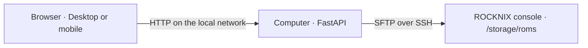

<div align="center">
  
  <h1>ROM Dock</h1>
  <p>Manage files and ROMs on handheld consoles from a web browser.</p>
  <p>React · TypeScript · FastAPI · SFTP</p>
</div>

ROM Dock is a local application for browsing, organizing, and transferring files between a computer and a console running ROCKNIX. The server runs on the computer; the interface is accessible from that computer or a phone on the same network.

The current version uses **SFTP over SSH** and has been validated on an **Anbernic RG40XX V running ROCKNIX**. Support for other consoles, operating systems, and SMB/Samba connections is part of the [roadmap](#roadmap). The project is under active development. **The application interface is currently in Portuguese; this documentation is in English.**


## Contents

- [Features](#features)
- [Screenshots](#screenshots)
- [Compatibility](#compatibility)
- [Installation](#installation)
- [Connecting to a console](#connecting-to-a-console)
- [Usage](#usage)
- [Covers and artwork](#covers-and-artwork)
- [Transfers and file integrity](#transfers-and-file-integrity)
- [Configuration](#configuration)
- [Security and privacy](#security-and-privacy)
- [Development and testing](#development-and-testing)
- [Architecture](#architecture)
- [Troubleshooting](#troubleshooting)
- [Roadmap](#roadmap)
- [Contributing](#contributing)
- [Licensing and attribution](#licensing-and-attribution)

## Features

| Area | Available functionality |
| --- | --- |
| File explorer | Grid and list views, search within the current folder, filters, direct sorting controls, and continuous browsing without pagination |
| Organization | Folder creation, renaming, file deletion, and deletion of empty folders |
| Transfers | Multiple uploads, downloads, progress, cancellation, and confirmation before overwriting |
| Systems | Local system icons, persistent favorites, and filters for systems with or without ROMs |
| Preview | Images, video, audio, PDF, text, and a hexadecimal sample for other files |
| Covers | Reading existing artwork associations and managing images manually |
| Interface | Light and dark themes, adjustable grid size, and independently collapsible side panels |
| Navigation | History, keyboard shortcuts, context menus, and edge gestures on mobile |
| Access | Application access code, browser sessions, and SSH host identity verification |
| Accessibility | Labeled controls, keyboard navigation, and support for reduced motion preferences |

Display preferences, favorites, and panel states are stored in the browser. Automatic import, external catalogs, automatic game identification, and scraping are not available.

## Screenshots

These screenshots were generated from the application using **synthetic data and artwork created for this project**. They contain no ROMs, credentials, personal data, or commercial cover art. They show the current Portuguese interface. The generator is available in [`frontend/scripts/capture-screenshots.mjs`](frontend/scripts/capture-screenshots.mjs).

### Covers and information in dark mode


### List view in light mode


### Collapsed side panels


### Mobile

<p>
  
  
</p>

## Compatibility

| Component | Current status |
| --- | --- |
| Validated console | Anbernic RG40XX V |
| Console operating system | ROCKNIX |
| Protocol | SFTP over SSH with password authentication |
| File root | `/storage/roms`, currently fixed |
| Server | Computer with Python and Node.js; automated startup requires Bash |
| Client | Modern desktop or mobile browser |
| Other consoles and distributions | Not validated; changes may be required |
| SMB/Samba, WebDAV, FTP, and local storage | Not implemented |

The computer must remain running while the application is in use. A phone communicates with the server on the computer, which performs SFTP operations on the console. The application is not installed on the console.

## Installation

### Requirements

- Python **3.11 or later**, with virtual environment support.
- Node.js **22.12 or later**, with npm.
- Bash to use `start.sh`; on Windows, use WSL or adapt the manual startup commands.
- A console running ROCKNIX with networking and SSH enabled.
- Internet access for the initial dependency installation.

Development and validation were performed on Linux with Python 3.14 and Node.js 22. Compatibility with other versions and host operating systems should be verified in the target environment.

### Automated startup

```bash
git clone https://github.com/jpbjesus/rom-dock.git
cd rom-dock
./start.sh
```

The script creates `.venv`, installs Python and JavaScript dependencies, builds the interface, and starts the server. The terminal displays the local URL, network URL, and access code.

On the computer, open **http://localhost:8765**. On a phone, open `http://<COMPUTER-IP>:8765` and enter the code displayed in the terminal. Keep the terminal open; `Ctrl+C` stops the server.

Once installed, the application runs locally. Fonts, icons, and interface assets are served by the computer itself.

### Manual installation

```bash
python3 -m venv .venv
source .venv/bin/activate
python -m pip install -r requirements.lock
npm --prefix frontend ci
npm --prefix frontend run build
python -m backend.app
```

## Connecting to a console

1. Connect the computer and console to the same local network.
2. Enable the SSH service in the ROCKNIX settings.
3. Find the console's IP address in its network information.
4. Enter the address, SSH port, username, and password in the application.
5. On the first connection, verify and accept the SSH host key fingerprint.

The usual SSH port is `22`. Check the username and password in the console settings; the application neither supplies nor stores a default password. Depending on the ROCKNIX version and language, the administrator password can be found under **System Settings → Security → Root Password**.

Accepted host identities are stored in `.runtime/trusted-hosts.json`. A changed key requires confirmation again. SSH credentials remain only in server memory and are discarded when the server restarts.

## Usage

The interface currently uses Portuguese labels. English descriptions and their corresponding labels are provided below.

### Browse and organize

- Open a folder to view its contents.
- Switch between grid and list views and adjust the grid size.
- Sort by **Name** (`Nome`), **Size** (`Tamanho`), or **Modified** (`Modificado`); select the same field again to reverse the direction.
- Search within the open folder and filter files or folders.
- Select an item to inspect it in the information panel; on mobile, use **Information** (`Informação`).
- Use **Navigation** (`Navegação`) and **Information** (`Informação`) in the top bar to collapse or expand the panels. The right panel also has its own control.
- Use the context menu to access available file operations.

### Favorites and system filters

The star next to a system adds it to or removes it from favorites. Favorite systems appear in a dedicated sidebar section.

The **Filter systems** (`Filtrar sistemas`) selector offers **All systems** (`Todos os sistemas`), **With ROMs** (`Com ROMs`), and **Without ROMs** (`Sem ROMs`). The filter applies to the sidebar and system folders at the explorer root; it does not modify console contents.

Detection checks recognized ROM extensions, including subfolders, and excludes artwork, video, and other asset directories. It does not validate the contents of ROM files. Scans are limited to 200 directories per system and 500 per request. Systems with incomplete scans are treated as unknown and appear only under **All systems**. Switching between the two ROM filters reuses the same scan result.

### Preview and navigation

| Action | Control |
| --- | --- |
| Preview a file | Double-click, use the preview button, or select a file and press `Space` |
| Close a preview or dialog | `Esc` |
| Go back on desktop | `Alt + ←` or the Back button |
| Go forward on desktop | `Alt + →` or the Forward button |
| Go back on mobile | Swipe inward from the left edge |
| Go forward on mobile | Swipe inward from the right edge |

Video and audio playback depend on browser format and codec support. PDF display depends on the viewer available on the device. Text previews are bounded; binary files show a hexadecimal sample. The original file remains available for download.

### After uploading games

On the console, refresh the game list through:

**START → Game Settings → Update Gamelists**

Menu labels may vary by language and ROCKNIX version. The application displays this instruction after completed uploads and in the information panel. It does not refresh the console's game list automatically.

## Covers and artwork

The explorer reads existing image associations from `gamelist.xml`. If no reference is present, it may use an image with the same base filename in the system's `images` folder.

The **Cover** (`Capa`) section in the information panel for an eligible file supports:

- Uploading or replacing a PNG, JPEG, or WebP image, up to **8 MB and 16 megapixels**.
- Associating an image already present in the system's `images` folder.
- Removing an association while preserving the image files.

Before replacing an existing `gamelist.xml`, the application backs up its original bytes in `<system>/.romdock-backups/`. The file revision is checked before the change. Previous images are preserved; an uncertain publication result caused by a network failure does not trigger deletion of the new image.

Uploaded images are reprocessed and resized to a maximum dimension of 1600 pixels. Changes may require refreshing the game list in ROCKNIX.

## Transfers and file integrity

Uploads use temporary files and publish the final file only after the transfer completes. Overwriting requires atomic rename support from the SFTP server. If that operation is unavailable, overwriting is rejected to preserve the original.

Each operation is tied to the connection on which it was created. Reconnecting does not redirect an existing transfer to another console.

Current limitations:

- Interrupted uploads cannot resume automatically.
- The queue belongs to the browser; refreshing or closing the page interrupts that flow.
- A network failure or abrupt shutdown may leave `.romdock-*.part` files on the console, hidden from the listing.
- Only empty folders can be deleted.
- Operations are restricted to the root currently defined in code, `/storage/roms`.
- Symbolic links cannot be opened or used to escape the configured root.

## Configuration

| Variable | Default | Purpose |
| --- | --- | --- |
| `ROMDOCK_PORT` | `8765` | HTTP server port |
| `ROMDOCK_ACCESS_CODE` | Generated at each startup | Optional operator-defined access code |
| `ROMDOCK_CONSOLE_HOST` | Requested interactively | Console address used by live integration tests |
| `ROMDOCK_SCREENSHOT_URL` | `http://127.0.0.1:8765` | Server URL used to generate demonstration screenshots |

Start the server on another port:

```bash
ROMDOCK_PORT=8766 .venv/bin/python -m backend.app
```

Do not commit access codes, passwords, private keys, or runtime files. The generated startup code avoids the need to define a persistent secret.

## Security and privacy

The application is intended for a **trusted local network**. The server listens on the computer's network interfaces. Browser access uses HTTP; the connection between the computer and console uses SSH. Do not expose the application port directly to the Internet.

- Authenticated sessions expire after 12 hours.
- SSH host identity is verified, including key changes.
- Paths are validated and symbolic links are blocked.
- Console operations validate the connection generation.
- Text and HTML previews are displayed as inert content.
- Images are processed with size and resolution limits.
- No analytics, remote catalogs, or external runtime services are used.

Authenticated sessions on the same instance share a console connection. There is no user isolation, account system, or per-folder authorization. The access code protects a personal instance; it is not a public multi-user hosting solution.

## Development and testing

### Development server and interface

```bash
# Terminal 1 — Python server
.venv/bin/python -m backend.app

# Terminal 2 — Vite, with an API proxy to port 8765
npm --prefix frontend run dev
```

### Automated checks

```bash
.venv/bin/python -m pytest -q
npm --prefix frontend run build

# Install the test browser once
cd frontend
npx playwright install chromium

# With the Python server running on port 8765
npm test
```

Interface tests simulate the console and require no ROMs or SSH credentials. From the project root, run formatting with `npm --prefix frontend run format`.

### Generate screenshots

With the server running and Chromium installed:

```bash
node frontend/scripts/capture-screenshots.mjs
```

The script uses synthetic data and writes to `docs/screenshots/` without contacting the console. Screenshots reflect the application's current interface language.

### Live integration tests

```bash
.venv/bin/python -m tests.live_check
.venv/bin/python -m tests.live_covers
```

These optional tests **write to unique temporary folders on the console**. They request the access code and SSH password interactively. The general test checks transfers, SHA-256, overwriting, renaming, and subfolders. The cover test checks associations, backups, and image preservation.

SSH trust must be established before running them. The general test reads `~/.ssh/known_hosts`; the cover test expects a host identity already accepted in the application and existing SNES artwork. Tests clean up their artifacts when they finish, but an interruption may require manual removal of the temporary folder.

## Architecture



```text
backend/
  app.py           Sessions, API, static files, and streaming
  remote.py        SFTP, host identity, paths, and atomic publication
  systems.py       Bounded checks for ROM presence
  covers.py        Images, gamelist updates, and backups
  preview.py       Text, images, binary content, and HTTP ranges
frontend/
  src/App.tsx      Sessions, connections, favorites, panels, and transfers
  src/components/  Explorer, information, covers, themes, and previews
  public/          Favicon and local system icons
  scripts/         Reproducible screenshots with demonstration data
tests/             Python tests and optional live integration tests
frontend/tests/    Playwright interface tests
docs/screenshots/  Documentation screenshots
```

## Troubleshooting

| Symptom | Checks |
| --- | --- |
| The phone cannot open the application | Check the computer's IP, network connectivity, and firewall permissions; guest networks may isolate devices |
| The console does not respond | Check that it is powered on and its IP address is correct |
| SSH connection refused | Check that SSH is enabled and the port is correct |
| Authentication rejected | Verify the username and password in the console settings |
| SSH host identity changed | Verify whether the console was reinstalled, replaced, or its key changed before accepting |
| Uploaded games do not appear | Check the destination folder and refresh the game list on the console |
| A system is missing from a filter | The scan may be incomplete or the format unrecognized; select **All systems** |
| Video or audio does not play | The browser may not support the codec; download the file for a compatible player |
| The access code no longer works | Check the terminal; restarting the server generates a new code |
| Interface changes are not visible | Refresh the page and verify that `npm --prefix frontend run build` completed |

## Roadmap

The following items are planned improvements and **are not implemented in the current version**.

- [ ] Device adapters independent of console manufacturers and distributions.
- [ ] Multiple console profiles, addresses, and configurable file roots.
- [ ] **SMB/Samba** support for network shares.
- [ ] Evaluation of additional protocols, including WebDAV, FTP/FTPS, and local storage.
- [ ] Additional authentication methods, including SSH keys.
- [ ] Local network device discovery and diagnostics.
- [ ] Protocol capability detection for atomic rename, permissions, and streaming.
- [ ] Resumable transfers, integrity verification, and more resilient queues.
- [ ] Simplified packaging and installation for Windows, macOS, and Linux.
- [ ] Interface and documentation internationalization, including an English interface.
- [ ] A community-validated compatibility matrix.

Multi-protocol support should retain a consistent interface while identifying operations that cannot provide the same integrity guarantees as the current SFTP implementation.

## Contributing

Report problems and propose improvements through [Issues](https://github.com/jpbjesus/rom-dock/issues). Include the host operating system, browser version, console model, console distribution, and reproduction steps. Remove passwords, access codes, and personal data from logs and screenshots.

Before submitting changes, run the Python tests, TypeScript/Vite build, and interface tests. Changes to protocols or file access should cover path validation, authentication, and failure handling. See [CONTRIBUTING.md](CONTRIBUTING.md).

## Licensing and attribution

The project's code license will be added once selected by the author. Public source availability does not itself grant permission to use or redistribute the code.

Controller icons come from **Controllercons** by Kieran McClung, distributed under the **SIL Open Font License 1.1**. License and attribution files are included in [`frontend/public/system-icons/`](frontend/public/system-icons/). Additional handheld symbols and demonstration artwork were created for this project. Dependencies retain their respective licenses.

This repository does not distribute ROMs, BIOS files, games, or commercial cover artwork.
