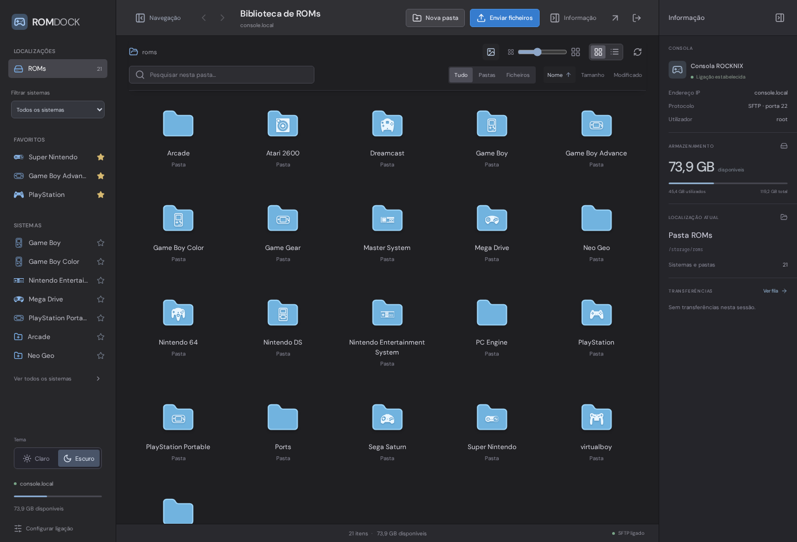
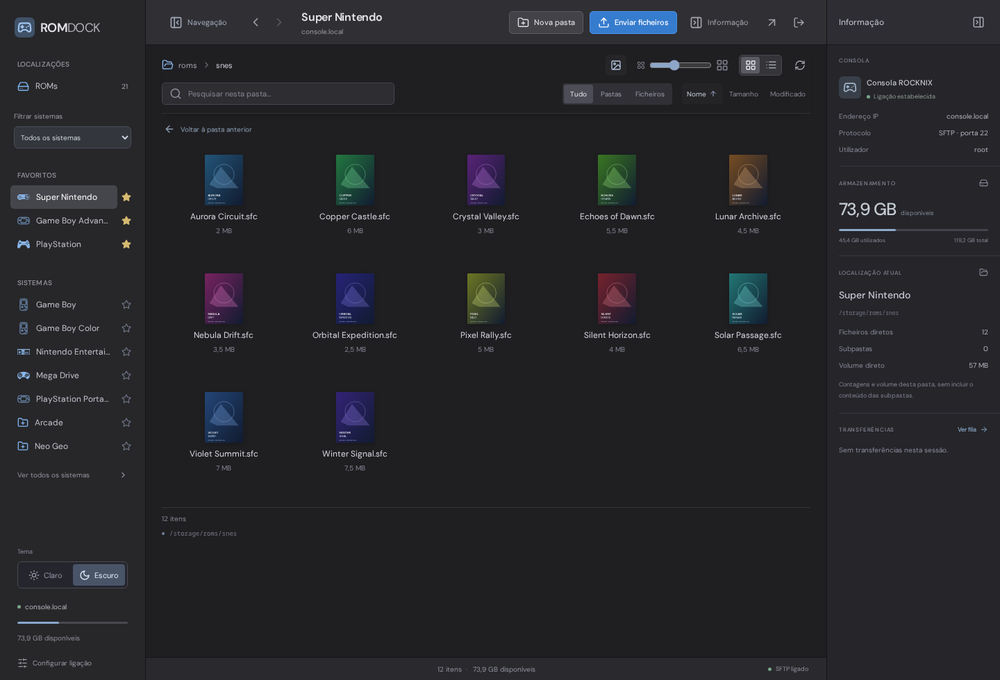
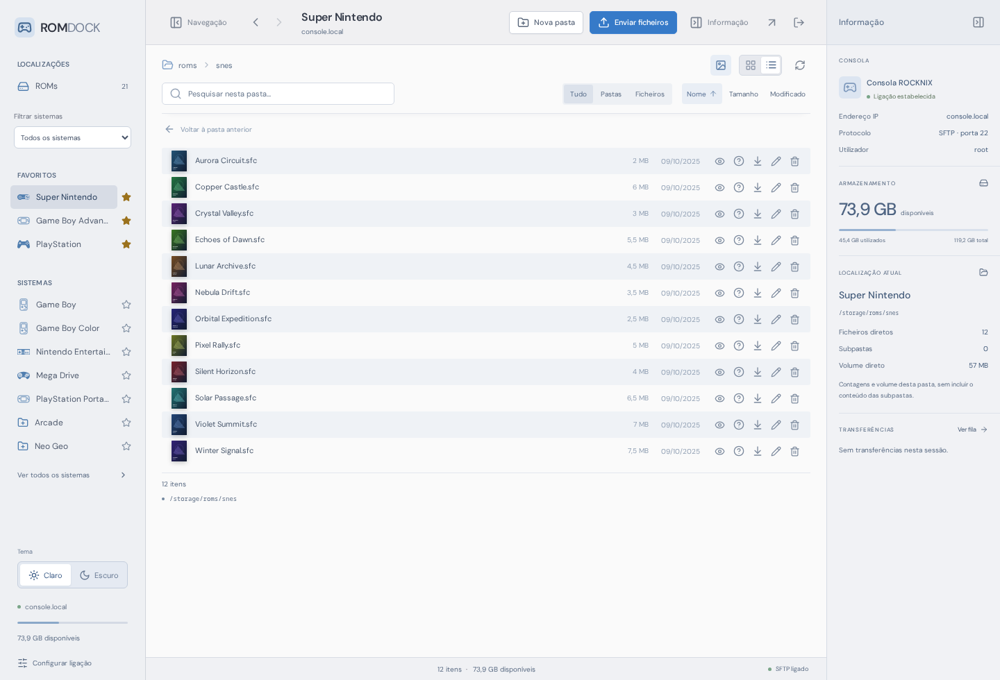
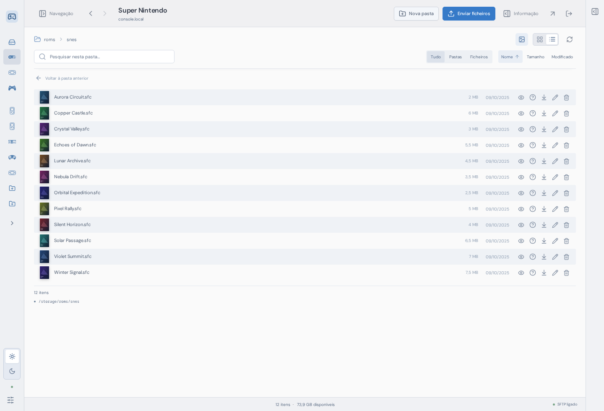
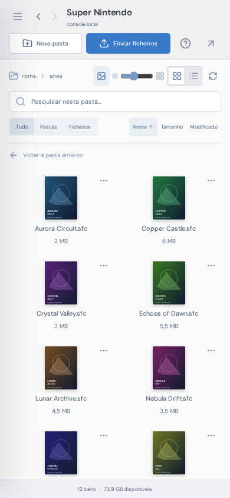
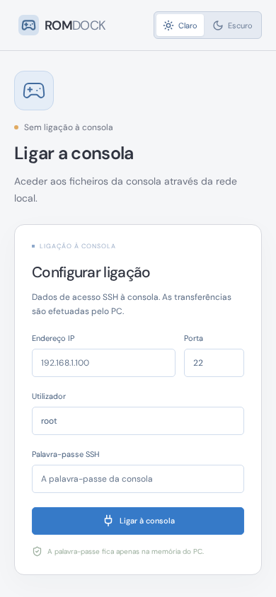
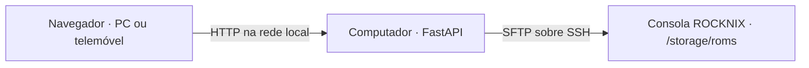

<div align="center">
  
  <h1>ROM Dock</h1>
  <p>Gestão de ficheiros e ROMs para consolas portáteis, a partir do navegador.</p>
  <p>React · TypeScript · FastAPI · SFTP</p>
</div>

ROM Dock é uma aplicação local para consultar, organizar e transferir ficheiros entre um computador e uma consola com ROCKNIX. O servidor é executado no computador; a interface pode ser utilizada no próprio computador ou num telemóvel ligado à mesma rede.

A versão atual utiliza **SFTP sobre SSH** e foi validada numa **Anbernic RG40XX V com ROCKNIX**. O suporte a consolas genéricas, outros sistemas e ligações SMB/Samba faz parte do [trabalho futuro](#trabalho-futuro). O projeto encontra-se em desenvolvimento ativo.



## Índice

- [Funcionalidades](#funcionalidades)
- [Capturas de ecrã](#capturas-de-ecrã)
- [Compatibilidade](#compatibilidade)
- [Instalação](#instalação)
- [Ligação à consola](#ligação-à-consola)
- [Utilização](#utilização)
- [Capas e imagens](#capas-e-imagens)
- [Transferências e integridade dos ficheiros](#transferências-e-integridade-dos-ficheiros)
- [Configuração](#configuração)
- [Segurança e privacidade](#segurança-e-privacidade)
- [Desenvolvimento e testes](#desenvolvimento-e-testes)
- [Arquitetura](#arquitetura)
- [Resolução de problemas](#resolução-de-problemas)
- [Trabalho futuro](#trabalho-futuro)
- [Contribuições](#contribuições)
- [Licenciamento e atribuições](#licenciamento-e-atribuições)

## Funcionalidades

| Área | Disponível |
| --- | --- |
| Explorador | Grelha e lista, pesquisa na pasta atual, filtros, ordenação direta e navegação contínua sem paginação |
| Organização | Criação de pastas, renomeação, eliminação de ficheiros e de pastas vazias |
| Transferências | Envio múltiplo, descarga, progresso, cancelamento e confirmação antes de substituir |
| Sistemas | Ícones locais, favoritos persistentes e filtros para sistemas com ROMs ou sem ROMs |
| Pré-visualização | Imagens, vídeo, áudio, PDF, texto e amostra hexadecimal de outros ficheiros |
| Capas | Leitura de associações existentes e gestão manual de imagens |
| Interface | Temas claro e escuro, tamanho da grelha ajustável e painéis laterais independentes |
| Navegação | Histórico, atalhos de teclado, menu de contexto e gestos nas margens em telemóvel |
| Acesso | Código da aplicação, sessão no navegador e confirmação da identidade SSH |
| Acessibilidade | Controlos identificados, navegação por teclado e respeito pela preferência de movimento reduzido |

As preferências de apresentação, os favoritos e o estado dos painéis são guardados no navegador. Não existe importação automática, catálogo externo, identificação automática de jogos ou scraping.

## Capturas de ecrã

As capturas foram produzidas pela aplicação com **dados e imagens de demonstração criados para este projeto**. Não incluem ROMs, credenciais, dados pessoais ou capas comerciais. O gerador encontra-se em [`frontend/scripts/capture-screenshots.mjs`](frontend/scripts/capture-screenshots.mjs).

### Capas e informação em modo escuro



### Vista em lista e modo claro



### Painéis laterais encolhidos



### Telemóvel

<p>
  
  
</p>

## Compatibilidade

| Componente | Situação atual |
| --- | --- |
| Consola validada | Anbernic RG40XX V |
| Sistema da consola | ROCKNIX |
| Protocolo | SFTP sobre SSH, com autenticação por palavra-passe |
| Pasta de ficheiros | `/storage/roms`, atualmente fixa |
| Servidor | Computador com Python e Node.js; arranque automatizado para ambientes com Bash |
| Cliente | Navegador moderno em computador ou telemóvel |
| Outras consolas e distribuições | Não validadas; podem exigir alterações |
| SMB/Samba, WebDAV, FTP e armazenamento local | Não implementados |

O computador deve permanecer ligado durante a utilização. O telemóvel comunica com o servidor no computador, que efetua as operações SFTP na consola. A aplicação não é instalada na consola.

## Instalação

### Requisitos

- Python **3.11 ou superior**, com suporte para ambientes virtuais.
- Node.js **22.12 ou superior**, com npm.
- Bash para utilizar `start.sh`; em Windows, utilizar WSL ou adaptar o arranque manual.
- Consola com ROCKNIX, rede e serviço SSH ativo.
- Acesso à Internet para a instalação inicial das dependências.

O desenvolvimento e a validação foram efetuados em Linux, com Python 3.14 e Node.js 22. A compatibilidade com outras versões e sistemas anfitriões deverá ser confirmada no respetivo ambiente.

### Arranque automático

```bash
git clone https://github.com/jpbjesus/rom-dock.git
cd rom-dock
./start.sh
```

O script cria `.venv`, instala as dependências Python e JavaScript, compila a interface e inicia o servidor. O terminal apresenta o endereço local, o endereço de rede e o código de acesso.

No computador, abrir **http://localhost:8765**. No telemóvel, abrir `http://<IP-DO-COMPUTADOR>:8765` e introduzir o código apresentado no terminal. O terminal deve permanecer aberto; `Ctrl+C` encerra o servidor.

O funcionamento após a instalação é local. As fontes, os ícones e a interface são servidos pelo próprio computador.

### Instalação manual

```bash
python3 -m venv .venv
source .venv/bin/activate
python -m pip install -r requirements.lock
npm --prefix frontend ci
npm --prefix frontend run build
python -m backend.app
```

## Ligação à consola

1. Ligar o computador e a consola à mesma rede local.
2. Ativar o serviço SSH nas definições do ROCKNIX.
3. Consultar o endereço IP da consola nas informações de rede.
4. Preencher o endereço, a porta SSH, o utilizador e a palavra-passe na aplicação.
5. Na primeira ligação, verificar e confirmar a impressão digital da chave SSH.

A porta habitual é `22`. Confirmar o utilizador e a palavra-passe nas definições da consola; a aplicação não fornece nem guarda uma palavra-passe predefinida. No ROCKNIX, a palavra-passe de administração pode ser consultada em **System Settings → Security → Root Password**, consoante a versão e o idioma.

As identidades aceites ficam em `.runtime/trusted-hosts.json`. Se a chave mudar, a aplicação exige nova confirmação. As credenciais SSH permanecem apenas na memória do servidor e são descartadas quando este é reiniciado.

## Utilização

### Explorar e organizar

- Abrir uma pasta para consultar o respetivo conteúdo.
- Alternar entre grelha e lista e ajustar o tamanho da grelha.
- Utilizar **Nome**, **Tamanho** ou **Modificado** para ordenar; repetir o clique inverte a direção.
- Pesquisar na pasta aberta e filtrar ficheiros ou pastas.
- Selecionar um item para consultar a informação lateral; em telemóvel, utilizar **Informação**.
- Utilizar **Navegação** e **Informação**, na barra superior, para encolher ou expandir os painéis. O painel direito também dispõe de um controlo próprio.
- Utilizar o menu de contexto para as operações disponíveis.

### Favoritos e filtros de sistemas

A estrela junto de cada sistema adiciona ou remove esse sistema dos favoritos. Os favoritos aparecem numa secção própria da barra lateral.

O seletor **Filtrar sistemas** disponibiliza **Todos os sistemas**, **Com ROMs** e **Sem ROMs**. O filtro aplica-se à barra lateral e às pastas dos sistemas na raiz do explorador; não altera o conteúdo da consola.

A deteção considera extensões de ROM reconhecidas, incluindo subpastas, e ignora diretórios de imagens, vídeos e outros recursos. Não valida o conteúdo de cada ROM. A pesquisa tem um limite de 200 diretórios por sistema e 500 por pedido. Sistemas cuja verificação fique incompleta são considerados indeterminados e aparecem apenas em **Todos os sistemas**. Alternar entre os dois filtros utiliza o mesmo resultado da verificação.

### Pré-visualizar e navegar

| Ação | Controlo |
| --- | --- |
| Pré-visualizar um ficheiro | Duplo clique, botão de pré-visualização ou seleção seguida de `Espaço` |
| Fechar pré-visualização ou diálogo | `Esc` |
| Retroceder no PC | `Alt + ←` ou botão Retroceder |
| Avançar no PC | `Alt + →` ou botão Avançar |
| Retroceder em telemóvel | Deslizar da margem esquerda para o interior |
| Avançar em telemóvel | Deslizar da margem direita para o interior |

Vídeo e áudio dependem dos formatos e codecs suportados pelo navegador. A apresentação de PDF depende do visualizador disponível no dispositivo. Os ficheiros de texto têm uma pré-visualização limitada; ficheiros binários apresentam uma amostra hexadecimal. A descarga do ficheiro permanece disponível.

### Depois de enviar jogos

Na consola, atualizar a lista em:

**START → Game Settings → Update Gamelists**

Os nomes dos menus podem variar com o idioma ou a versão do ROCKNIX. A aplicação apresenta esta instrução nas transferências concluídas e no painel lateral. Não atualiza automaticamente a lista de jogos da consola.

## Capas e imagens

O explorador lê as associações de imagem existentes em `gamelist.xml`. Na ausência de uma referência, pode utilizar uma imagem com o mesmo nome base na pasta `images` do sistema.

A secção **Capa**, no painel de informação de um ficheiro elegível, permite:

- Adicionar ou substituir uma imagem PNG, JPEG ou WebP, até **8 MB e 16 megapíxeis**.
- Associar uma imagem já existente na pasta `images` do sistema.
- Remover a associação, preservando os ficheiros de imagem.

Antes de substituir um `gamelist.xml` existente, é criada uma cópia dos bytes originais em `<sistema>/.romdock-backups/`. A revisão do ficheiro é verificada antes da alteração. As imagens anteriores são preservadas e a publicação incerta por falha de rede não provoca a eliminação da nova imagem.

As imagens enviadas são reprocessadas e reduzidas a uma dimensão máxima de 1600 píxeis. As alterações podem exigir uma atualização da lista de jogos no ROCKNIX.

## Transferências e integridade dos ficheiros

Os envios utilizam ficheiros temporários e só publicam o ficheiro final após a transferência. A substituição depende de renomeação atómica no servidor SFTP; quando esta operação não está disponível, a substituição é recusada para preservar o original.

Cada operação fica associada à ligação em que foi criada. Uma reconexão não redireciona uma transferência para outra consola.

Limitações atuais:

- Não existe retoma automática de envios interrompidos.
- A fila pertence ao navegador; atualizar ou fechar a página interrompe o respetivo fluxo.
- Uma falha de rede ou encerramento abrupto pode deixar ficheiros `.romdock-*.part` na consola, ocultos na listagem.
- Apenas pastas vazias podem ser eliminadas.
- As operações ficam limitadas à raiz configurada no código, `/storage/roms`.
- Ligações simbólicas não podem ser abertas nem usadas para contornar a raiz.

## Configuração

| Variável | Valor predefinido | Finalidade |
| --- | --- | --- |
| `ROMDOCK_PORT` | `8765` | Porta HTTP do servidor |
| `ROMDOCK_ACCESS_CODE` | Gerado em cada arranque | Código de acesso opcional definido pelo operador |
| `ROMDOCK_CONSOLE_HOST` | Pedido interativamente | Endereço utilizado pelos testes de integração reais |
| `ROMDOCK_SCREENSHOT_URL` | `http://127.0.0.1:8765` | Endereço do servidor para gerar capturas de demonstração |

Exemplo de arranque noutra porta:

```bash
ROMDOCK_PORT=8766 .venv/bin/python -m backend.app
```

Não colocar códigos de acesso, palavras-passe, chaves privadas ou ficheiros de execução no repositório. O código gerado no arranque evita a necessidade de definir um segredo persistente.

## Segurança e privacidade

A aplicação destina-se a uma **rede local de confiança**. O servidor escuta nas interfaces de rede do computador. A interface utiliza HTTP; a ligação entre o computador e a consola utiliza SSH. Não publicar diretamente a porta na Internet.

- Sessões autenticadas com duração de 12 horas.
- Confirmação da identidade SSH e controlo de alterações da chave.
- Validação dos caminhos e bloqueio de ligações simbólicas.
- Validação da geração da ligação nas operações associadas à consola.
- Texto e HTML apresentados como conteúdo inerte na pré-visualização.
- Imagens processadas com limites de tamanho e resolução.
- Ausência de analítica, catálogos remotos e serviços externos em execução.

As sessões autenticadas de uma instância partilham a mesma ligação à consola. Não existe isolamento entre utilizadores, sistema de contas ou permissões por pasta. O código de acesso protege uma instância pessoal; não constitui uma solução de alojamento público com múltiplos utilizadores.

## Desenvolvimento e testes

### Servidor e interface de desenvolvimento

```bash
# Terminal 1 — servidor Python
.venv/bin/python -m backend.app

# Terminal 2 — Vite, com proxy da API para a porta 8765
npm --prefix frontend run dev
```

### Verificações automáticas

```bash
.venv/bin/python -m pytest -q
npm --prefix frontend run build

# Instalar o navegador de teste uma vez
cd frontend
npx playwright install chromium

# Com o servidor Python ativo na porta 8765
npm test
```

Os testes de interface simulam a consola. Não necessitam de ROMs nem de credenciais SSH. A formatação pode ser executada com `npm --prefix frontend run format`, a partir da raiz do projeto.

### Gerar capturas de ecrã

Com o servidor ativo e Chromium instalado:

```bash
node frontend/scripts/capture-screenshots.mjs
```

O script utiliza dados sintéticos e escreve em `docs/screenshots/`, sem contactar a consola.

### Testes de integração reais

```bash
.venv/bin/python -m tests.live_check
.venv/bin/python -m tests.live_covers
```

Estes testes são opcionais e **escrevem em pastas temporárias exclusivas na consola**. Solicitam o código de acesso e a palavra-passe interativamente. O teste geral verifica transferências, SHA-256, substituição, renomeação e subpastas; o teste de capas verifica associações, cópias de segurança e preservação de imagens.

É necessário preparar a confiança SSH antes da execução. O teste geral consulta `~/.ssh/known_hosts`; o teste de capas pressupõe uma identidade já aceite na aplicação e imagens SNES existentes. Os testes limpam os seus artefactos no final, mas uma interrupção pode exigir limpeza manual da pasta temporária.

## Arquitetura



```text
backend/
  app.py           Sessões, API, ficheiros estáticos e streaming
  remote.py        SFTP, identidade SSH, caminhos e publicação atómica
  systems.py       Verificação limitada de presença de ROMs
  covers.py        Imagens, gamelist e cópias de segurança
  preview.py       Texto, imagens, conteúdo binário e intervalos HTTP
frontend/
  src/App.tsx      Sessão, ligação, favoritos, painéis e transferências
  src/components/  Explorador, informação, capas, temas e pré-visualização
  public/          Favicon e ícones locais de sistemas
  scripts/         Capturas reproduzíveis com dados de demonstração
tests/             Testes Python e integração opcional
frontend/tests/    Testes de interface com Playwright
docs/screenshots/  Capturas para a documentação
```

## Resolução de problemas

| Sintoma | Verificações |
| --- | --- |
| O telemóvel não abre a aplicação | Confirmar o IP do computador, a mesma rede e a autorização da porta na firewall; redes de convidados podem isolar dispositivos |
| A consola não responde | Confirmar que está ligada e que o endereço IP está correto |
| Ligação SSH recusada | Confirmar que o serviço SSH está ativo e que a porta está correta |
| Autenticação recusada | Rever o utilizador e a palavra-passe nas definições da consola |
| A identidade SSH mudou | Verificar se houve reinstalação, troca de consola ou alteração da chave antes de aceitar |
| Os jogos não aparecem após o envio | Confirmar a pasta de destino e atualizar a lista de jogos na consola |
| Um sistema não aparece num filtro | A verificação pode estar incompleta ou o formato não ser reconhecido; consultar **Todos os sistemas** |
| Vídeo ou áudio não reproduz | O navegador pode não suportar o codec; descarregar o ficheiro para um leitor compatível |
| O código de acesso deixou de funcionar | Consultar o terminal; um novo código é gerado após reiniciar o servidor |
| As alterações da interface não aparecem | Atualizar a página e confirmar que `npm --prefix frontend run build` foi executado |

## Trabalho futuro

Os pontos seguintes são objetivos de evolução e **não estão implementados na versão atual**.

- [ ] Camada de adaptação a dispositivos, independente de fabricantes e distribuições.
- [ ] Perfis para várias consolas e endereços, com seleção da raiz de ficheiros.
- [ ] Suporte a **SMB/Samba** e partilhas de rede.
- [ ] Avaliação de outros protocolos, incluindo WebDAV, FTP/FTPS e armazenamento local.
- [ ] Métodos adicionais de autenticação, incluindo chaves SSH.
- [ ] Descoberta e diagnóstico de dispositivos na rede local.
- [ ] Deteção de capacidades por protocolo: renomeação atómica, permissões e streaming.
- [ ] Retoma de transferências, verificação de integridade e filas mais resilientes.
- [ ] Empacotamento e instalação simplificados para Windows, macOS e Linux.
- [ ] Internacionalização da interface e da documentação.
- [ ] Matriz de compatibilidade validada pela comunidade.

A evolução para vários protocolos deverá manter uma interface coerente e indicar quando uma operação não oferece as mesmas garantias de integridade disponíveis em SFTP.

## Contribuições

Relatórios de problemas e propostas de melhoria podem ser apresentados nas [Issues](https://github.com/jpbjesus/rom-dock/issues). Incluir o sistema anfitrião, a versão do navegador, o modelo da consola, a distribuição e passos de reprodução. Remover palavras-passe, códigos de acesso e dados pessoais de registos ou capturas.

Antes de propor alterações, executar os testes Python, a compilação TypeScript/Vite e os testes de interface. Alterações a protocolos ou ao acesso a ficheiros devem incluir verificações de caminhos, autenticação e comportamento em caso de falha.

## Licenciamento e atribuições

A licença do código do projeto será indicada no repositório após a escolha pelo autor. A disponibilização pública do código não substitui uma licença de utilização ou distribuição.

Os ícones de controladores são da coleção **Controllercons**, de Kieran McClung, sob **SIL Open Font License 1.1**. A licença e a atribuição encontram-se em [`frontend/public/system-icons/`](frontend/public/system-icons/). Os símbolos complementares de portáteis e as imagens de demonstração são produzidos pelo projeto. As dependências mantêm as respetivas licenças.

O repositório não distribui ROMs, BIOS, jogos ou capas comerciais.
